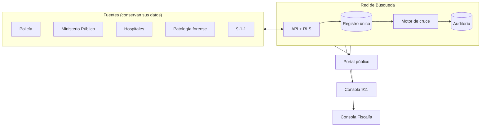
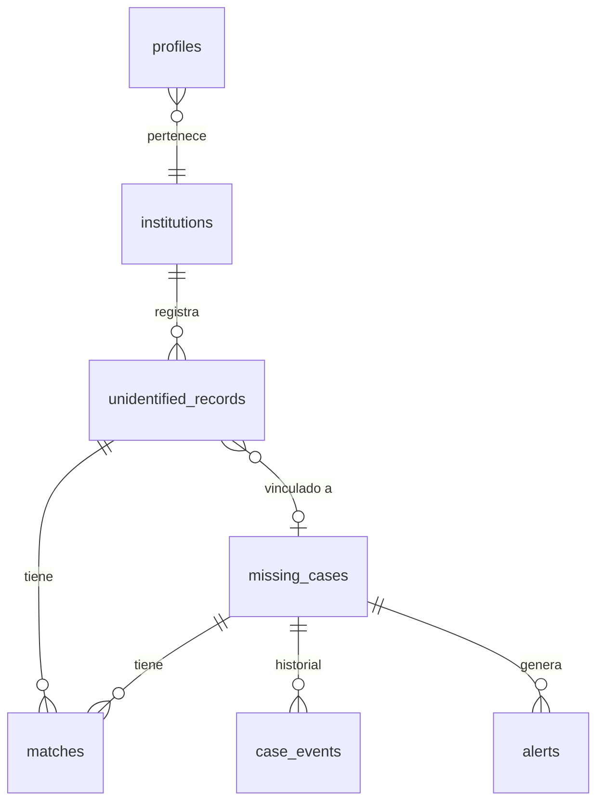

# Arquitectura

## El problema en una línea

Las personas desaparecidas muchas veces ya están registradas en otra institución —hospital, destacamento, patología forense— y nadie cruza esos registros con la denuncia.

Cifras reales que motivan el proyecto (no se usan como datos en el sistema):

| Fuente | Periodo | Denuncias |
| --- | --- | --- |
| Policía Nacional ([Acento](https://acento.com.do/actualidad/aumentan-los-casos-de-personas-desaparecidas-en-republica-dominicana-mas-de-3300-reportes-desde-2022-9644377.html)) | ene 2022 – feb 2026 | 3,313 (2,651 vivos, 397 sin vida, 265 pendientes) |
| ASODOFADE ([CDN](https://cdn.com.do/investigacion/epidemia-de-desapariciones-familias-sin-respuestas/)) | jun 2022 – feb 2025 | 2,242 |
| Procuraduría General ([CDN](https://cdn.com.do/investigacion/epidemia-de-desapariciones-familias-sin-respuestas/)) | ene 2021 – dic 2024 | 1,334 |

## Vista general

Hoy la demo implementa la caja central completa y simula las fuentes con datos ficticios.

## Capas del código

| Capa | Dónde | Responsabilidad | No hace |
| --- | --- | --- | --- |
| Dominio | `packages/domain` | Tipos, validación (Zod), catálogo de señas, reglas de visibilidad | I/O, UI |
| Motor | `packages/matching` | Puntuar y ordenar pares denuncia ↔ registro | Decidir identidades, leer BD |
| Datos | `apps/web/src/lib/data` | Puerto `Repository` + adaptadores Mock y Supabase | Reglas de negocio nuevas |
| UI | `apps/web/src/app`, `components` | Server Components, Server Actions, mapa | Acceso directo a la BD |
| Base de datos | `supabase/migrations` | Esquema, RLS, triggers de transición y auditoría, prefiltro geográfico | Puntuar |

El patrón es puertos y adaptadores: la UI depende de la interfaz `Repository`, no de Supabase. Por eso la demo corre sin base de datos (`DATA_SOURCE=mock`) con exactamente las mismas pantallas.

## Flujo de un cruce

1. Llega una denuncia (`missing_cases`) o un registro NN (`unidentified_records`).
2. La función SQL `candidate_records(case_id)` reduce el universo con índices: mismo sexo, sin vincular, posterior a la desaparición, edad y estatura plausibles, dentro de un radio (PostGIS `ST_DWithin`). Respeta RLS y deja registro en `audit_log`.
3. `@rb/matching` puntúa cada candidato y devuelve factores legibles.
4. Un operador envía a verificación; Fiscalía confirma (huellas, ADN o reconocimiento familiar). Un trigger impide que otro rol cierre el caso.
5. Al confirmar, el registro queda vinculado, el caso se cierra y la ficha pública desaparece.

El cruce inverso (registro nuevo contra casos abiertos) se dispara con `pg_notify('nuevo_registro', id)`; falta el worker que lo escuche (ver roadmap).

## Modelo de datos

Ubicaciones en `geography(Point, 4326)`. Las vistas `*_api` exponen `lng`/`lat` planos para PostgREST con `security_invoker`, así RLS sigue aplicando.

## Ingesta de cifras públicas (planificada)

Para el panel de cifras reales: un paquete `packages/ingest` que lea portales de transparencia y notas de prensa y guarde **solo agregados** (fuente, periodo, total, por provincia), nunca nombres ni fotos. Respetar `robots.txt` y los términos de cada sitio, guardar la URL de origen de cada cifra y revisarla a mano antes de publicarla.
